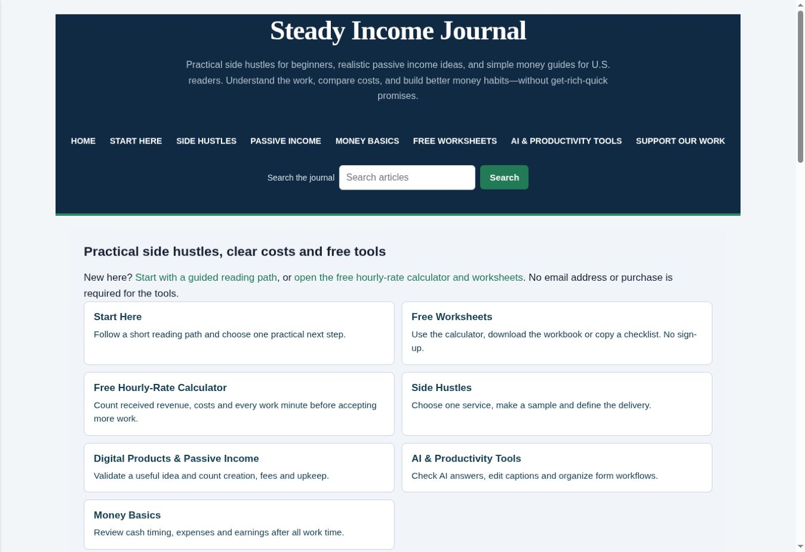

# Steady Income Journal

## Apresentação e objetivo
Publicar conteúdo em inglês sobre renda extra e ferramentas digitais.

## Participação real e inteligência artificial
Daniel de Omena Loubaque é responsável pelos objetivos, decisões de produto e acompanhamento do projeto. Desenvolvimento e documentação contam com IA; não se afirma autoria manual exclusiva nem experiência formal como desenvolvedor contratado.

## Tecnologias utilizadas
Blogger, tema XML, HTML e automação editorial assistida por IA. Tecnologias identificadas no projeto não equivalem a domínio avançado individual.

## Arquitetura
Blogger hospeda páginas e artigos; tema XML identificado no repositório privado OmniHub; rotina editorial agendada separadamente.

## Funcionalidades
Artigos, organização editorial, referências e divulgação de afiliação quando aplicável.

## Demonstração
https://steadyincomejournal.blogspot.com/

## Capturas de tela
As capturas devem mostrar páginas públicas, sem sessões, tokens ou dados de terceiros. Consulte as imagens reais disponíveis no pacote do portfólio; nenhuma imagem sintética é apresentada como captura.

## Instalação
Estudo editorial, sem backend próprio para instalar. A personalização exige acesso autorizado ao Blogger e cópia de segurança do tema.

## Testes e limites de validação
Revisão editorial e checagem de links devem anteceder cada publicação. Não há suíte de testes confirmada neste estudo.

## Desafios técnicos
Preservar originalidade, qualidade de fontes e transparência comercial.

## Soluções implementadas
Fluxo de pesquisa, redação e revisão assistido por IA; agendamento existente não é evidência de que todas as publicações ocorreram.

## Próximas melhorias
Validar páginas institucionais, links, revisão editorial e funcionamento da rotina; avaliar métricas verificadas.

## Segurança
Este documento foi escrito para publicação, sem copiar histórico, credenciais ou dados comerciais privados. Os originais privados permanecem privados. Auditoria documental em 14/11/2026; não constitui garantia de ausência de vulnerabilidades.

## Contato
[Daniel no GitHub](https://github.com/Danielloubaque) · [LinkedIn](https://www.linkedin.com/in/daniel-loubaque-58443a240/) · [Vyntriva Tech](https://vyntriva-tech.bakedcharm.chatgpt.site)

## Captura real da página pública

## Software House & Digital Solutions — 15/11/2026

Este projeto integra o portfólio técnico da Vyntriva Tech, conduzida pelo fundador e CEO Daniel Loubaque com apoio de IA. Serviços de Front-end, Back-end, Full Stack, automação e integrações são definidos por escopo e viabilidade; esta documentação não afirma domínio avançado nem resultados comerciais.

Site oficial: https://vyntriva-tech.onrender.com/ · Estudos técnicos: https://vyntriva-tech.onrender.com/portfolio.html

As capturas existentes representam o projeto na data da preparação. Automações e integrações precisam de verificação individual antes de serem apresentadas como operacionais.
